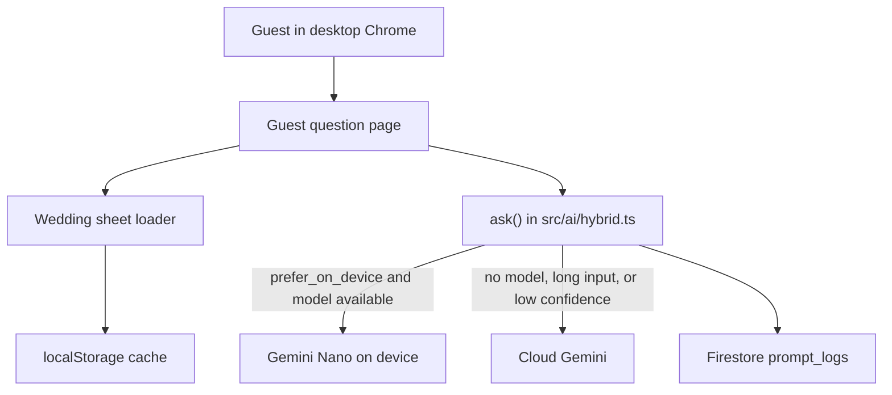

# Boda Lista

Boda Lista helps a couple run their wedding from a desktop Chrome web app. Feature 1 is a guest question page: an invitee asks about the schedule, dress code, venue, parking, gifts, or contacts, and the answer has to come from the wedding sheet. Feature 2 is RSVP at `/rsvp`: the guest pastes a WhatsApp-style reply in Spanish or English, hybrid inference extracts the schema fields, and the guest confirms the card before it is saved.

The app is a `#BuildHybridAI` 2026 entry. Prompts go through Firebase AI Logic hybrid inference. Chrome uses Gemini Nano on the device when that model is available, and the same call falls back to the cloud Gemini model when it is not.

The interface is Spanish first and also accepts English questions. Direction A, Izote y Barro, lives in `src/styles/tokens.css` and `src/styles/tokens.json`.

## Hybrid architecture



`ask(prompt, context)` always creates the model with `InferenceMode.PREFER_ON_DEVICE`. There is no force-on-device switch. The route badge reads the SDK `inferenceSource` (`on_device` or `in_cloud`). If that signal is missing, the app checks `window.LanguageModel.availability()`.

Each call writes one `prompt_logs` document. The document stores sizes and routing metadata, never the prompt, the answer, or a guest name.

| Field | Value |
| --- | --- |
| `ts` | UTC ISO timestamp |
| `feature` | `guest_question`, `rsvp`, or `song` (the `task` values in `data/schema.json`) |
| `route` | `device` or `cloud` |
| `fallback_reason` | `no_model`, `low_confidence`, `long_input`, `no_threshold`, `offline_no_threshold`, or null |
| `latency_ms` | Inference time |
| `input_chars` | Characters sent to the model |
| `output_chars` | Characters returned |
| `model` | `gemini-nano` or the cloud model id |
| `confidence` | Caller-supplied number, or null. An RSVP row is updated in this browser with the model's confidence after a valid extraction. |
| `session_id` | Random id stored in the browser |
| `edited_by_guest` | RSVP rows only. `false` when the log is written, then `true` in this browser's debug panel if the guest changes the card before sending. |

Cloud fallback reasons: `no_model` when Gemini Nano is not available, `long_input` when the prompt is over 8000 characters, and `low_confidence` when a numeric `cloud_cutoff` is set and the caller passes a confidence below it. If `high` or `cloud_cutoff` is null, there is no band: online answers use the cloud model with reason `no_threshold`, and offline answers use Gemini Nano with reason `offline_no_threshold` and the label "Respuesta poco segura". A device route with an active threshold stores a null reason.

Guests can create those rows. Only a signed-in Google user can read them, from `/admin`. Firestore rules reject every other field, so a client cannot attach the question text.

A confirmed RSVP is a separate `rsvps` document: invite code, `attending`, `party_size`, `meal_restrictions`, `kids_count`, `needs_ride`, `ambiguous`, `edited`, and `ts`. Rules allow create only when that shape is valid. The raw message and guest names are not stored. Invalid model JSON is sent once more to the cloud model; if that is still unreadable, the confirmation card opens empty with a revisa note. `ambiguous` or `maybe` highlights the fields to check. With the current null thresholds, an online extraction is `cloud` / `no_threshold`, and an offline extraction is Gemini Nano, route `device`, reason `offline_no_threshold`, labeled "Respuesta poco segura".

## Wedding sheet

The wedding sheet follows `data/schema.json` (`wedding_info`: `synthetic`, `disclaimer`, `couple.bride` / `couple.groom`, `date`, `timezone`, `schedule`, `venue`, `dress_code`, `parking`, `gifts`, `contacts`). `src/data/loadWeddingInfo.ts` loads `data/wedding_info.json` when that file is in the build, and otherwise uses `src/data/wedding_info.sample.json`. The loader caches the sheet in `localStorage` so an on-device answer can still use it offline. Names, addresses, and phone numbers in both sheets are synthetic.

If the sheet does not cover a question, the only acceptable answer is:

`No tengo esa información, pregúntale a los novios`

## Setup

Requirements: Node.js 22 (the version used in CI) or newer, and a Firebase project with AI Logic, App Check (reCAPTCHA Enterprise), Firestore, Auth (Google), and Hosting. `npm install` may print an engine warning from the Firebase package. The app runs in the browser, and Node 22 is enough to build and test it.

```bash
npm install
cp .env.example .env
```

Fill `.env` from Firebase console → Project settings, plus the reCAPTCHA Enterprise site key used for App Check. Do not commit `.env`. For local cloud calls, set `VITE_APPCHECK_DEBUG_TOKEN` to `true`, copy the token printed in the browser console, and register it under App Check → Manage debug tokens. You can also paste an already registered token into that variable. Production Hosting builds must leave the debug token unset.

On-device inference needs desktop Chrome 139 or newer and the flag below. It does not need a network once the model is downloaded.

## Run locally

```bash
npm run dev
```

Open the URL Vite prints (usually `http://127.0.0.1:5173`). The guest page is `/`. RSVP is `/rsvp` (also the Confirmar tab). The organizer page is `/admin`. An invite code can be passed as `/rsvp?code=FAM1`.

## Firebase emulators

`.firebaserc` points at the demo project `demo-boda-lista`, which the emulators can start without a live service account.

```bash
npx firebase-tools emulators:start
```

In `.env`:

```bash
VITE_USE_EMULATORS=true
```

Then run `npm run dev`. Auth uses `http://127.0.0.1:9099` and Firestore uses `127.0.0.1:8080`. The emulator UI is `http://127.0.0.1:4000`. The emulators cover Auth and Firestore. Cloud Gemini requests still go to the real Firebase project, and on-device Gemini Nano does not use the emulator.

Deploy rules and hosting to a real project with:

```bash
npx firebase-tools deploy --only firestore:rules,hosting
```

## Deploy

Pushing to `main` runs `.github/workflows/firebase-hosting.yml`. It deploys to the live Hosting channel only when `FIREBASE_SERVICE_ACCOUNT` and `FIREBASE_PROJECT_ID` are set. If either secret is missing, the job skips and stays green. That workflow does not set `VITE_ENABLE_DEBUG`.

Pull requests run `.github/workflows/firebase-hosting-preview.yml`. It publishes a preview channel per PR, expires the channel after 7 days, and comments the preview URL. It sets `VITE_ENABLE_DEBUG=true` for that build. It skips the same way when the Firebase secrets are missing.

Optional build secrets, used when present: `VITE_FIREBASE_API_KEY`, `VITE_FIREBASE_AUTH_DOMAIN`, `VITE_FIREBASE_PROJECT_ID`, `VITE_FIREBASE_STORAGE_BUCKET`, `VITE_FIREBASE_MESSAGING_SENDER_ID`, `VITE_FIREBASE_APP_ID`, `VITE_FIREBASE_MEASUREMENT_ID`, `VITE_APPCHECK_SITE_KEY`, and `VITE_GEMINI_CLOUD_MODEL`.

## Environment variables

| Variable | Purpose |
| --- | --- |
| `VITE_FIREBASE_API_KEY` | Web app config |
| `VITE_FIREBASE_AUTH_DOMAIN` | Web app config |
| `VITE_FIREBASE_PROJECT_ID` | Web app config |
| `VITE_FIREBASE_STORAGE_BUCKET` | Web app config |
| `VITE_FIREBASE_MESSAGING_SENDER_ID` | Web app config |
| `VITE_FIREBASE_APP_ID` | Web app config |
| `VITE_FIREBASE_MEASUREMENT_ID` | Optional Analytics id |
| `VITE_APPCHECK_SITE_KEY` | reCAPTCHA Enterprise site key |
| `VITE_APPCHECK_DEBUG_TOKEN` | Local App Check debug token, or `true` |
| `VITE_USE_EMULATORS` | `true` to use Auth and Firestore emulators |
| `VITE_GEMINI_CLOUD_MODEL` | Optional. Default `gemini-3.5-flash-lite` |
| `VITE_ENABLE_DEBUG` | Preview builds only. Leave unset in production |

## Design tokens

Direction A, Izote y Barro, is applied. Colors, type, spacing, and radii live in `src/styles/tokens.css` and `src/styles/tokens.json`. Fraunces and Figtree are self-hosted from `src/styles/fonts/` under the SIL Open Font License 1.1. Components use the semantic tokens only. Body text is 18px and controls are at least 48px. The screen references stay in `design/`.

## Testing instructions for judges

Live URL: Firebase Hosting publishes this project at `https://<FIREBASE_PROJECT_ID>.web.app` (and `https://<FIREBASE_PROJECT_ID>.firebaseapp.com`) after the `main` workflow runs. This repo does not hard-code a project id. On a pull request, the preview workflow comments a temporary URL when `FIREBASE_SERVICE_ACCOUNT` and `FIREBASE_PROJECT_ID` are configured. That preview channel expires after 7 days.

Guest pages do not require a login. `/` is the question page. `/rsvp` is the RSVP page. `/admin` is optional and asks for Google sign-in only so an organizer can read `prompt_logs` and saved RSVPs.

On-device test (this is the real Gemini Nano path):

1. Use desktop Chrome 139 or newer (`chrome://settings/help`).
2. Set `chrome://flags/#prompt-api-for-gemini-nano-multimodal-input` to Enabled and restart Chrome.
3. In DevTools, `await LanguageModel.availability()` should be `available`, `downloadable`, or `downloading`. If it is `downloadable`, run `await LanguageModel.create()` and wait until it reports `available`.
4. Ask a question on `/`. The badge **En tu teléfono** means the SDK reported `on_device`. The badge **En la nube** means the cloud model answered. The badge is the real route. Nothing in the app forces Nano.

Unsupported devices: phones, browsers other than desktop Chrome, and Chrome without the Prompt API follow the `prefer_on_device` fallback. The guest still gets an answer from the cloud model (default `gemini-3.5-flash-lite`). The badge says **En la nube**, and `prompt_logs.fallback_reason` is `no_model` when the on-device model is missing. Offline, the sheet is served from `localStorage`. The cloud model cannot answer offline; Nano can, after it has been downloaded.

`?debug=1` on preview channels and on `npm run dev`:

- Preview Hosting builds set `VITE_ENABLE_DEBUG=true`, so `https://<preview>/?debug=1` shows the debug panel.
- `npm run dev` shows the same panel at `http://127.0.0.1:5173/?debug=1`.
- The production deploy does not set `VITE_ENABLE_DEBUG`. A production URL ignores `?debug=1`.

The panel shows device-model availability, the route taken, whether an App Check token is present (`yes` or `no` only), and the last `prompt_log` document id from this browser session with `ts`, `feature`, `route`, `fallback_reason`, `latency_ms`, `input_chars`, `output_chars`, `model`, `confidence`, and `session_id`. RSVP rows also show `edited_by_guest`. It does not show the prompt, the answer, the raw RSVP message, the App Check token, or guest names.

App Check is initialized with reCAPTCHA Enterprise. For a local cloud call, register `VITE_APPCHECK_DEBUG_TOKEN` in the Firebase console. Do not ship that token in the public Hosting build.

Out-of-scope check: ask something the sample sheet does not contain, in Spanish or English. The answer should be exactly `No tengo esa información, pregúntale a los novios`.

## Tests

```bash
npm test
npm run build
npm run test:e2e
npm run lhci
```

`npm test` covers the hybrid wrapper with a mocked SDK. `npm run test:e2e` writes mobile (390×844) and desktop screenshots to `docs/screenshots/`. `npm run lhci` fails if accessibility drops below 95.

Third-party licenses are listed in `THIRD_PARTY.md`. The project license is Apache-2.0 (`LICENSE`).

## Credits

Direction A (Izote y Barro) uses Fraunces and Figtree, both SIL Open Font License 1.1, self-hosted in this repo. UI icons and the izote illustration were drawn for Boda Lista and are Apache-2.0, same as the project. The full asset list is `design/tokens/LICENSES.md`.

These open-source wedding sites informed the product. Nothing was copied from them: no code, assets, illustrations, photos, or copy. Details and demos are in `design/sources.md`.

- [rampatra/wedding-website](https://github.com/rampatra/wedding-website) is GPL-3.0. Ideas only, no code: an invite-code RSVP flow, plus add-to-calendar and directions next to the event.
- [dewanakl/undangan](https://github.com/dewanakl/undangan) is MIT. Idea: a personal link per guest.
- [sakeenah-wedding/template](https://github.com/sakeenah-wedding/template) is Apache-2.0. Idea: a restrained card and one accent action.
- [retros-id/simple-wedding-invitation](https://github.com/retros-id/simple-wedding-invitation). Idea: a typography-led hero with a wide-tracked date.
- [nguyenhuugiatri/iphone-wedding-invitation](https://github.com/nguyenhuugiatri/iphone-wedding-invitation). Idea: glanceable details, which became the quick-question chips.
- [ZEDLABS-TEKNOLOGI-INDONESIA/wedding-invitation](https://github.com/ZEDLABS-TEKNOLOGI-INDONESIA/wedding-invitation). Idea: an organizer view for the sheet. Its public demo did not respond when checked.
- [Starloss/wedding-invitation](https://github.com/Starloss/wedding-invitation) is MIT. Idea: one RSVP form per family, and song requests.
- [xsrazy/Wedify](https://github.com/xsrazy/Wedify) is MIT. Idea: a playlist-style song list.
- [lfrocharod/wedding-invitation-template](https://github.com/lfrocharod/wedding-invitation-template) is MIT for code. Its illustrations are not licensed and were not used. Idea: a headcount and an RSVP deadline line.
- [thesurajdev/wedding-invite](https://github.com/thesurajdev/wedding-invite) is MIT for code. Photos and music were excluded. Idea: add to calendar, and a reduced-motion setting.
- [nerln/wedding-invite-starter-kit](https://github.com/nerln/wedding-invite-starter-kit) is MIT. Idea: a maps button, a letter-spaced date, and reduced motion.

smith-wedding-demo has no license and was not used.
